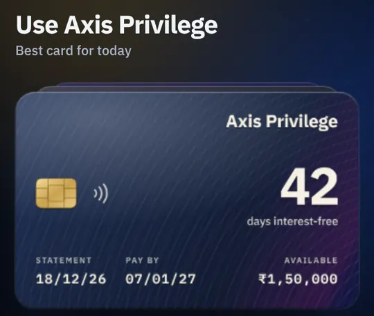
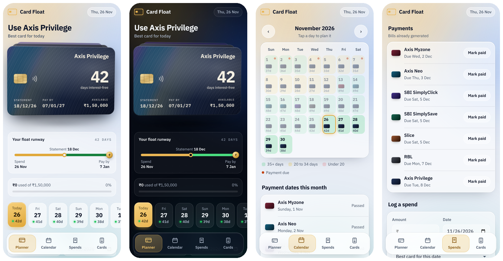
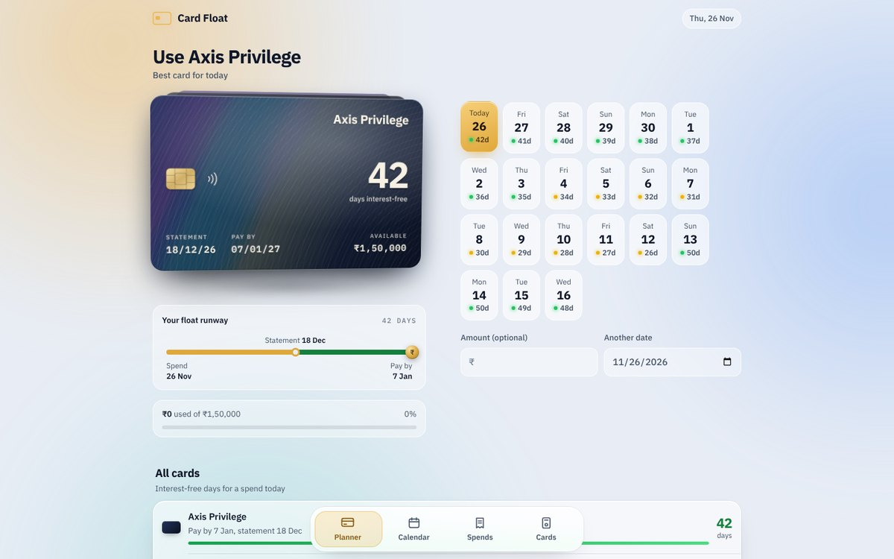

<h1 align="center">Card Float</h1>

<b>Which credit card should you swipe today?</b> 
The one that gives you the longest interest-free days, shown as a card that floats on your screen.

  <a href="https://maheshsurada9434.github.io/card-float-planner/"><b>Open the app</b></a>
  &nbsp;·&nbsp; Works offline &nbsp;·&nbsp; No sign-up &nbsp;·&nbsp; Your data stays on your phone

  

## Why

Every credit card bills on a different day. A spend made the day after a card's statement date waits a whole month before it is even billed, then gets the full grace period on top: often **45+ days of free credit**. The same spend on the wrong card can be due in under two weeks. Card Float works this out for every card you own, for any day, and tells you which one to use.

## Install on your phone

- **Android (Chrome):** open the live app and tap **Install app** at the top (or ⋮ menu → *Install app*).
- **iPhone (Safari):** open the live app, tap **Share** → **Add to Home Screen** → **Add**.

It opens full screen like a normal app and keeps working offline.

## Features

- **Planner** – your best card for today, shown as a real-looking credit card. Swipe the 3-week day strip to see the best card for any upcoming day, add an amount to skip cards without enough free limit, and see every card ranked by interest-free days.
- **Calendar** – the best card for each day of the month (shown as a mini card in its colour), colour-coded by float length, with dots on payment due dates. Tap a day to open it in the planner.
- **Spends** – log purchases (auto-assigned to the best card or picked manually), including EMI conversions. Shows statements that need paying, with one-tap **Mark paid**, current-cycle totals and limit usage per card.
- **Cards** – add, edit and delete cards. Statement day 29–31 is handled correctly in shorter months.
- **Reminders** – a *Due soon* list on the Planner shows payments due in the next 5 days (or overdue), plus a badge on the Spends tab.
- **Your data stays yours** – everything is saved automatically in the browser (`localStorage`). Export / import a JSON backup from the Cards tab to move between devices.
- **A card that floats** – the best card hovers in 3D with a moving glint and holographic sheen, your next two cards peek out behind it like a wallet, and it tilts as you move your mouse or your phone. Turn on *Reduce motion* and it stays still.
- **Premium card view** – a realistic credit card (chip, contactless mark, embossed dates) in the colour you pick for each card.
- Dark mode, mobile-first layout, keyboard and screen-reader friendly.

## How the math works

| Term | Meaning |
| --- | --- |
| Statement day | Day of the month the bill is generated. Spends on that day are included in it. |
| Grace period | Days from the statement date to the payment due date. |
| Float | Days from the spend date to the due date of the statement it lands in. |

A spend made the day *after* a card's statement date gets the maximum float (about one month + grace period).

**EMI spends** bill one installment on each statement, starting with the statement the purchase lands in. The unpaid principal keeps counting against your limit until the matching statements are marked paid.

## Privacy

Nothing leaves your device. There is no server, analytics or tracking.
